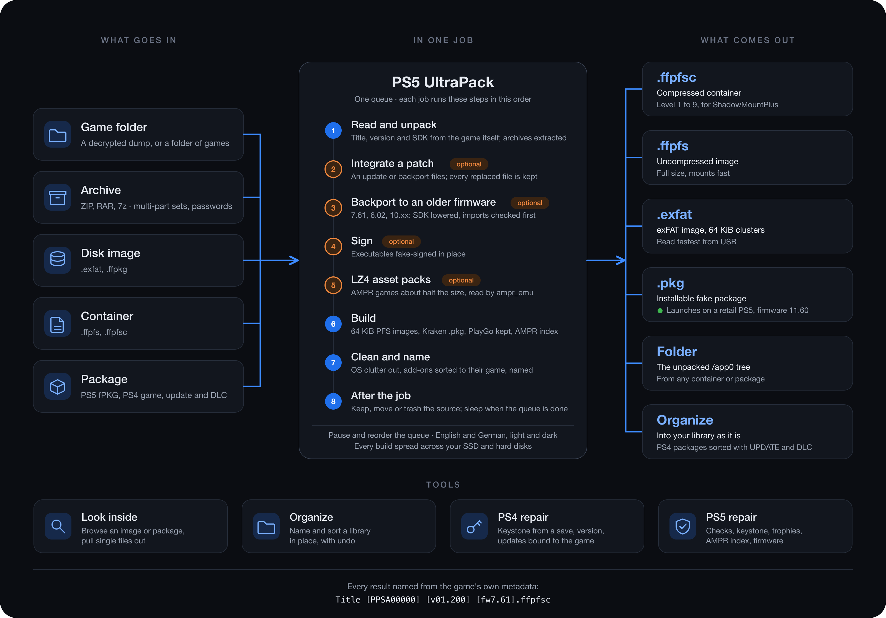
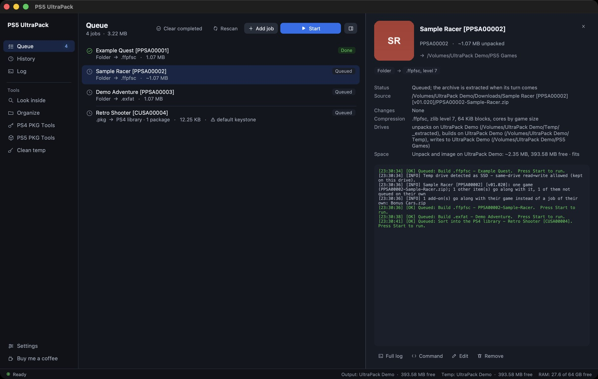
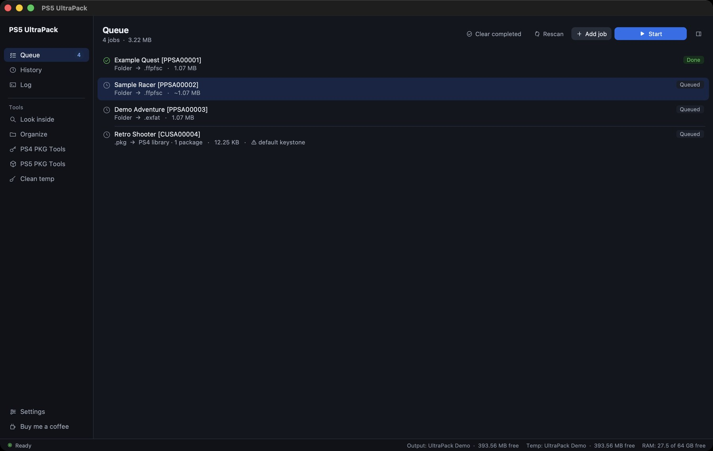
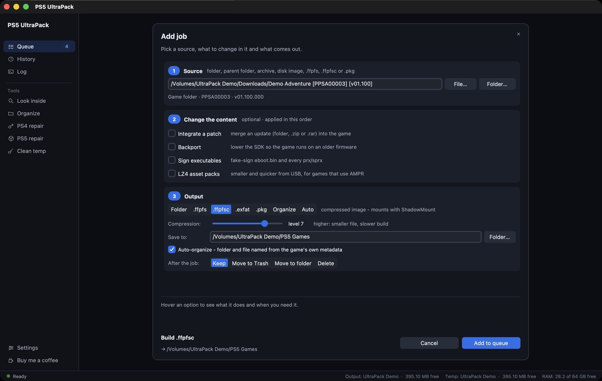
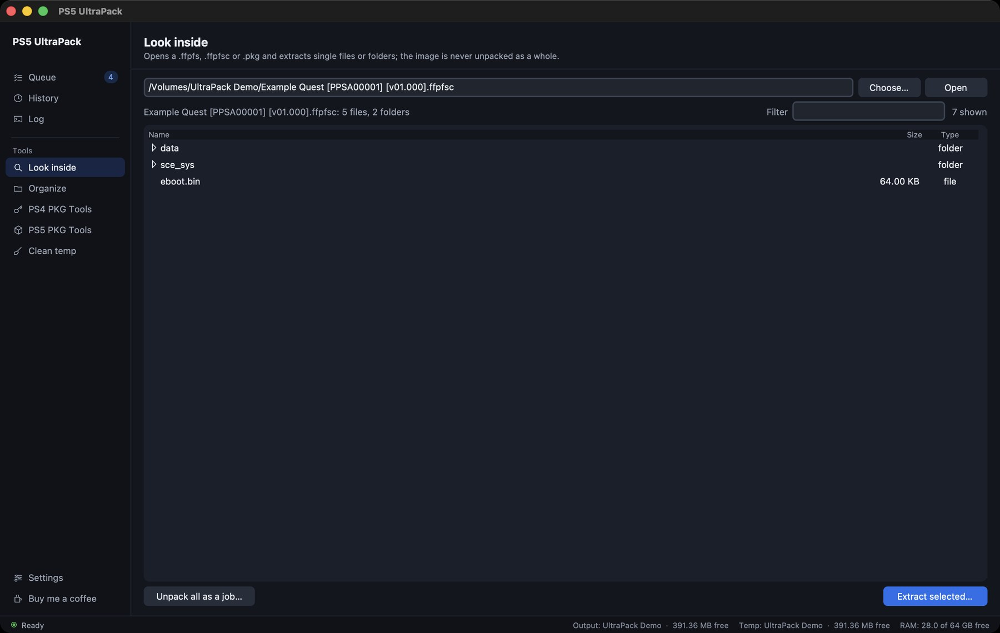
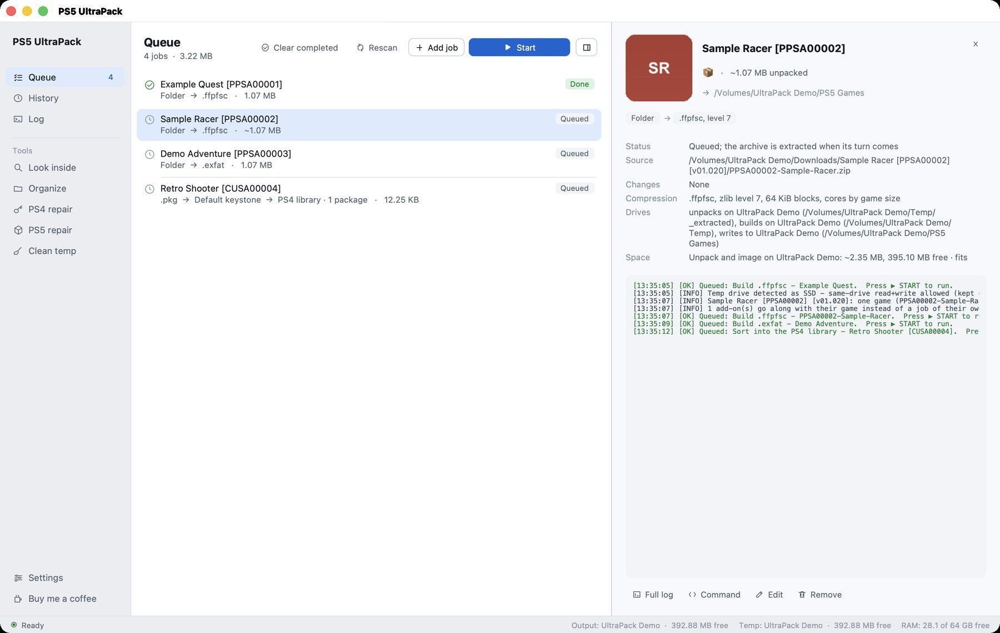
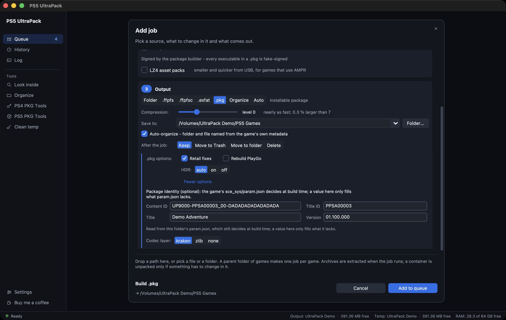
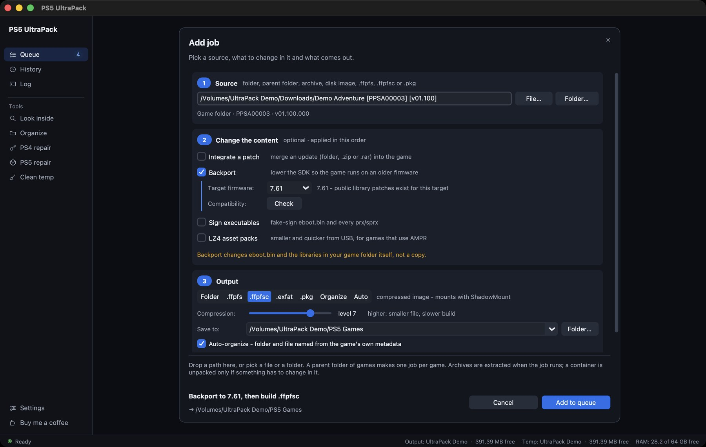
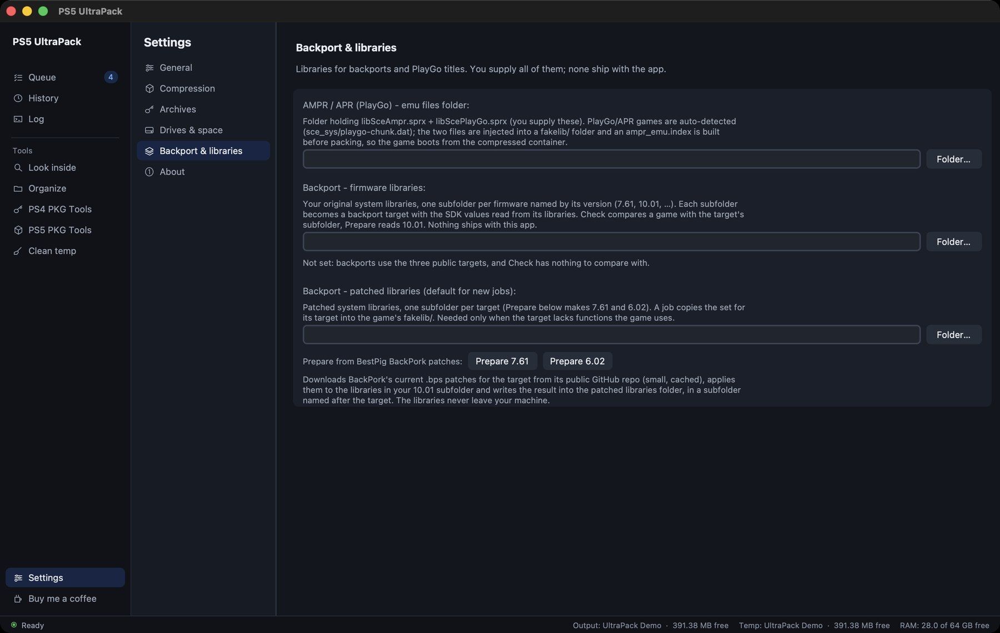

# PS5 UltraPack

<p align="center">
  
</p>

A desktop app for macOS and Windows that packs, converts, patches, backports and signs PS5 games, and builds installable `.pkg` files. You add a game folder, an archive, a disk image, a `.ffpfs`/`.ffpfsc` or a `.pkg`, pick what should happen to it and what should come out, and the queue works through it.

The app used to be called PS5 FFPFSC ULTRA.

<p align="center">
  
  <a href="https://github.com/knutwurst/ps5-ultrapack/releases/tag/v2.2.8-windows-preview.1"></a>
  
  
  
</p>

<p align="center">
  If you like what I do, you can buy me a coffee*: <a href="https://paypal.me/oliverkoester"></a><br>
  <sub>*It doesn't have to be a big donation. A few cents show me who uses the tool and cares about where it goes next. That keeps me motivated, and I know I'm not coding for the bin ;)</sub>
</p>

---

## Download

Grab the latest build from [Releases](https://github.com/knutwurst/ps5-ultrapack/releases).

- **macOS** 26 or newer on Apple Silicon: unzip and start the app. The app is only ad-hoc signed, so if macOS refuses to open it, run this once:
  ```bash
  xattr -dr com.apple.quarantine "PS5 UltraPack.app"
  ```
- **Windows x64** (preview): unzip and start `PS5 UltraPack.exe`. SmartScreen will warn on first start because the exe isn't signed ("More info", then "Run anyway"). Everything works on Windows 11 in my tests, but I haven't tried a package built on Windows on a console yet.

## Screenshots

<p align="center">
  
</p>

<table>
  <tr>
    <td align="center" width="50%"><br><sub>Queue</sub></td>
    <td align="center" width="50%"><br><sub>Add job</sub></td>
  </tr>
  <tr>
    <td align="center" width="50%"><br><sub>Look inside</sub></td>
    <td align="center" width="50%"><br><sub>Light mode</sub></td>
  </tr>
</table>

Older versions of the UI are in [docs/screenshots](docs/screenshots/README.md).

## What it does

**Inputs:** a decrypted game folder (`eboot.bin` + `sce_sys/param.json`), a folder full of games (one job each), ZIP/RAR/7z archives including multi-part RAR sets and encrypted headers, `.exfat`/`.ffpkg` disk images, `.ffpfs`, `.ffpfsc`, and PS5 or PS4 `.pkg` files.

**Outputs:** `.ffpfsc` (compressed), `.ffpfs` (uncompressed, faster to mount), an installable `.pkg`, a plain folder, or "Organize", which files the source into your library as it is.

**On the way** a job can integrate a patch, backport the game to an older firmware and fake-sign the executables, in that order. All of that happens on a working copy. Your source only changes if you ask for it (signing or backporting a folder in place), and if a patch job on your own folder fails, the patch is rolled back.

Some things that make day-to-day use easier:

- Archives can go straight in. Saved passwords are tried first, and the app only asks if none of them works. An archive with several games in it is unpacked once and each game gets its own job.
- Output files are named from the game itself: `<Title> [PPSA12345] [v01.200] [fw8.00].ffpfsc` in a folder per title. The firmware tag comes from the SDK version in `eboot.bin`. Names stay within ShadowMountPlus's length limit.
- Extras that come with a release (notes, checksums, backport files, DLC folders) don't go into the image, but they aren't thrown away either. They end up next to the output. macOS and Windows junk like `.DS_Store`, `._*` and `Thumbs.db` is dropped.
- Work is spread across drives. The image is built on your fast temp SSD and the result is written to the output drive. If the SSD is too small, the app splits the work or falls back to the output drive. A job that won't fit is skipped up front, with the numbers, so it doesn't fail halfway.
- The queue keeps its order, can be rearranged by drag and drop, and shows overall progress and time left. Failed jobs stay in the list and can be edited and retried. Pause lets the running job finish first.
- After a job the source can stay, go to the Trash, be moved somewhere or be deleted.

## Building `.pkg` files

The app builds PS5 debug fake packages natively, without Wine or Sony's DLL. It uses drakmor's LibProsperoPkg, wrapped in a small .NET tool that ships with the app.

I've tested this on a retail PS5 on firmware 11.60 with kstuff-lite: both homebrew and a retail game built this way install and launch, and the game keeps its saves. Which firmware a package runs on depends on the jailbreak, not on the builder.

<p align="center">
  
</p>

- Any input can become a `.pkg`. Content ID, title ID, version and title are read from the game's `param.json`. If a folder has none, "More options" asks for them.
- The app fixes common problems in the working copy before building, such as icons in the wrong format, stale DDS files or a PlayGo set that doesn't match the files. A broken `param.json` or an empty `eboot.bin` stops the build with a message.
- Every build is checked afterwards (container, signatures, PlayGo, images, license, NP files, versions, eboot). If something is off, the log tells you which check failed.
- Compression uses Kraken, level -4 to 9 (default 0). Higher levels take a lot longer for very little gain.
- It also works the other way round: a `.pkg` with "Folder" as output unpacks the whole game including `sce_sys`. Building that folder again gives the same file byte for byte.

## Backporting

<table>
  <tr>
    <td align="center" width="50%"><br><sub>Backport in Add job</sub></td>
    <td align="center" width="50%"><br><sub>Settings › Backport & libraries</sub></td>
  </tr>
</table>

A backport lowers the SDK version the game declares in `eboot.bin` and its modules. If the older firmware is missing functions the game uses, the game also needs patched system libraries in its `fakelib/` folder, which ShadowMountPlus loads instead of the system ones.

The app does the SDK part itself, also on fake-signed files (only the two SDK values inside the signature change). It doesn't ship any system libraries. You extract them from your own firmware, and the app can apply the public patches for you.

| Target | Notes |
|---|---|
| 7.61 | Public library patches exist. This is the usual route. |
| 6.02 | Experimental, smaller patch set, only some games run. |
| 10.xx | SDK only, for games slightly newer than the console. |
| Any firmware in your folder | SDK values taken from that firmware's own libraries. |

How to set it up:

1. In Settings › Backport & libraries, point the app at a folder with one subfolder per firmware (`7.61`, `9.60`, `10.01`, …), each containing that firmware's original libraries. Each subfolder shows up as a target.
2. Put your 10.01 libraries in the `10.01` folder, choose an output folder for patched libraries and click **Prepare 7.61** or **Prepare 6.02**. The app downloads the BPS patches from [BestPig/BackPork](https://github.com/BestPig/BackPork) and applies them.
3. In Add job, **Check** tells you whether a game runs on the target with a lower SDK alone or needs the patched libraries. Every build runs this check first and stops before touching anything if libraries are missing.

Whether a particular game runs after a backport depends on the game and on the jailbreak's fakelib support.

The same is available on the command line:

```bash
python3 backend/cli.py --backport-analyze <game folder> --backport-target 9.60 --fw-libs-root <firmware folder>
python3 backend/cli.py --prepare-backport-libs 7.61 --fw-libs-root <firmware folder> --backport-libs <patched folder>
python3 backend/cli.py <game>.ffpfsc <output folder> --to ffpfsc --backport-target 7.61 --fw-libs-root <firmware folder> --backport-libs <patched folder>
```

## Organize

Organize (in the sidebar) cleans up an existing library. Pick a folder and press Scan. You get a list of every game folder, image, package and archive in it with its current and new name. Apply only renames, so it's fast even on a large drive, and **Undo last organize** puts everything back.

Each game ends up in one title folder named after the newest version it has. PS4 packages get their own layout with UPDATE and DLC entries. Archives keep their file names. If the app can't tell which game an archive belongs to, it leaves that folder alone and says so.

## Look inside

Look inside opens a `.ffpfs`, `.ffpfsc` or `.pkg` and shows the file tree. You can extract single files or folders without unpacking the whole thing. Only the blocks you need are read and decompressed, so even a 100 GB container opens quickly. Extracted files are identical to the originals.

## Other bits

- **PlayGo/APR titles:** the app detects `playgo-chunk.dat`, adds the fakelib module and the `AMPRIDX3` index, and signs before indexing so the sizes are right.
- **HDR:** the HDR flag in `param.json` is kept in `.pkg` builds (`--fpkg-hdr-flag auto|on|off`). `python3 backend/cli.py --param-report <folder>` lists title ID, version, HDR flag, required system software and SDK version for a whole folder.
- **Fake-sign** uses a vendored, pure-Python `make_fself`. Files that are already signed are skipped, so running it twice is harmless.
- **Block size:** images are always packed with 64 KiB PFS blocks. Smaller blocks pass a local check but crash on the console.

## Running from source

You need Python 3.10 or newer.

```bash
python3 -m pip install customtkinter pillow tkinterdnd2 py7zr rarfile psutil cryptography
python3 -m pip install ./backend/unrar
python3 PS5_UltraPack.py
```

The RAR module needs a C++ compiler (Xcode Command Line Tools on macOS). For `.pkg` features build the fPKG helper once with `./BUILD_PKG_TOOL.sh` (needs the [.NET SDK](https://dotnet.microsoft.com/download) 9+). Without the bundled 7-Zip, the app uses an installed 7-Zip or falls back to a slower Python path for `.7z`. AES and Deflate64 ZIPs need 7-Zip in any case.

On Windows, `run.bat` installs the packages from `requirements-build.txt` and starts the app. Build the fPKG helper with `BUILD_PKG_TOOL.ps1`. `run.bat` doesn't build the RAR module, so RAR needs 7-Zip or WinRAR installed. Windows has a 260-character path limit unless long paths are enabled, so keep temp and output folders short (e.g. `D:\ps5`).

## Building the app

**macOS**, from the repo root in a virtual environment (the script refuses to run outside one). It builds the fPKG helper first, so it needs the .NET SDK 9+:

```bash
python3 -m venv .venv && source .venv/bin/activate
./BUILD_MACOS_APP.sh
```

This writes `dist/PS5 UltraPack.app` plus `dist/PS5-UltraPack-<version>-macos-arm64.zip` and its `.sha256`. `FETCH_7ZIP.sh` downloads the pinned 7-Zip binaries for the bundle.

**Windows:** build the native parts on a Mac first with `WIN_PYTHON=<copy of the Windows Python folder> ./BUILD_WINDOWS_PARTS.sh` (needs the .NET SDK and `mingw-w64`). Then run `BUILD_WINDOWS_APP.ps1` on Windows. It writes `dist\windows\PS5 UltraPack\PS5 UltraPack.exe` and the release zip.

## Credits

This isn't a fork, but it builds on a lot of other people's work. Thanks to:

- [Bizkut](https://github.com/bizkut/ps5-ffpfs-cli) for ps5-ffpfs-cli. `backend/cli.py` started out as its backend wrapper.
- [PSBrew](https://github.com/PSBrew/MkPFS) for MkPFS, which does the PFS images and compression (bundled, 1.0.0).
- [drakmor](https://github.com/drakmor/LibProsperoPkg) for LibProsperoPkg 1.2.0, used for building and reading `.pkg` files. My wrapper is in `backend/native/src/ffpfsc-pkg-tool/`.
- The ps5-payload-dev / flatz lineage for `make_fself` (BSD-3).
- RARLAB for [UnRAR](https://www.rarlab.com/), vendored as C++ source for the RAR module.
- The authors of ShadowMountPlus and MicroMount, which load the `.ffpfsc` containers.
- EchoStretch for kstuff-lite, and Drakmor and ArkSama for the fpkg launch fixes. Without them fPKG on 11.60 wouldn't launch at all.
- [BestPig](https://github.com/BestPig/BackPork) for the BackPork library patches.
- titoum-be, who got it running on Windows and sent the launcher and build script the Windows version is based on ([#1](https://github.com/knutwurst/ps5-ultrapack/issues/1)).

Python libraries: customtkinter, py7zr, rarfile, tkinterdnd2, Pillow, psutil, cryptography.

## License

The details, including trademark notes, are in [`NOTICES.md`](NOTICES.md). Short version:

- My own code (the GUI, the Python wrappers, the C# wrapper around LibProsperoPkg, tests and build scripts) is **MIT**, see [`LICENSE`](LICENSE).
- MkPFS 1.0.0 is **GPL-3.0-or-later** ([`backend/mkpfs/LICENSE`](backend/mkpfs/LICENSE)).
- LibProsperoPkg 1.2.0 is **GPL-3.0-or-later** ([`backend/native/LICENSE.LibProsperoPkg`](backend/native/LICENSE.LibProsperoPkg)).
- The UnRAR sources are under the **UnRAR license**: free for extraction, but they may not be used to build a RAR-compatible compressor ([`backend/unrar/license.txt`](backend/unrar/license.txt)).
- `make_fself.py` is **BSD-3-Clause**, attribution in the file header.
- Bizkut's ps5-ffpfs-cli has no license file. `backend/cli.py` started from it and has been mostly rewritten. I don't claim a license for what's left of the original code; MIT covers my changes. See `NOTICES.md`.

Because the compiled app includes MkPFS and LibProsperoPkg, the binaries are distributed as a combined work under **GPL-3.0-or-later**. Everything needed to rebuild them is in this repo, including the LibProsperoPkg assembly (original and patched, with the patch tooling and a notice in `backend/native/src/ffpfsc-pkg-tool/lib/`).

Not affiliated with Sony Interactive Entertainment. "PlayStation" and "PS5" are their trademarks and are only used to name the console and formats this tool works with. The app processes files you provide. It doesn't decrypt or distribute any Sony content, firmware, keys or executables, and it's your responsibility to only use it with content you have the right to use (your own game dumps, homebrew you're allowed to redistribute).

---

### If you like what I do, you can buy me a coffee*: [](https://paypal.me/oliverkoester)
<sub>*It doesn't have to be a big donation. A few cents show me who uses the tool and cares about where it goes next. That keeps me motivated, and I know I'm not coding for the bin ;)</sub>
